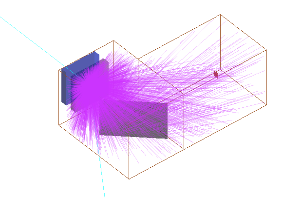

# G4LumaCam

A Geant4-based Simulator for LumaCam Event Camera



[](https://opensource.org/licenses/MIT)

## Overview

G4LumaCam is a Geant4-based simulation package for the LumaCam event camera that enables reconstruction of neutron events using the same analysis workflow as experimental data. The simulator generates standard Timepix-3 (TPX3) files that can be processed with various reconstruction tools, including the official EMPIR workflow. This flexibility allows researchers to simulate, validate, and optimize neutron detection setups before conducting physical experiments, reducing development time and costs.

## Key Features

- **High-Fidelity Physics**: Neutron interaction simulation based on Geant4 10.6 physics models
- **Realistic Optics**: Accurate optical ray tracing through the LumaCam lens system
- **Calibrated Detector Model (new in v0.6)**: the `gaussian_probabilistic` model is now the default, with parameters calibrated event-by-event against PTB fast-neutron data — intensifier point spread, P47 decay, pixels per photon, effective optical yield (~photocathode QE), and an intensifier-afterpulse satellite component (Mahon et al. 2024)
- **Optical Truth Reference**: `calibrate=True` traces a virtual point-source grid and tags every photon with its ideal landing position (`sim/x_opt`), isolating detector/reconstruction effects from lens optics
- **Advanced Detector Models**: 8 physics-based detector models including MCP+intensifier, Timepix3, and customizable phosphor screens (P20/P43/P46/P47)
- **Standard Output Format**: Generates TPX3 files compatible with multiple reconstruction tools
- **Same Reconstruction as Measured Data**: The simulated tpx3 files are reconstructed with EMPIR exactly like measured data, and associated with [neutron_event_analyzer](https://github.com/TsvikiHirsh/neutron_event_analyzer)
- **Configurable Sources**: Customizable neutron source properties (energy, spatial distribution, flux, etc.)
- **Efficient Processing**: Multi-process support for large-scale simulations
- **End-to-End Workflow**: From particle generation to reconstructed images

## Quick Start

Check out our new [detailed tutorial](https://github.com/TsvikiHirsh/G4LumaCam/blob/master/notebooks/G4LumaCam_Tutorial.ipynb) for a comprehensive guide covering simulation setup, ray tracing, and data analysis.

### Basic Usage

```python
import lumacam

# 1. Run neutron source simulation
sim = lumacam.Simulate("openbeam")
config = lumacam.Config.neutrons_uniform_energy()
df = sim.run(config)

# 2. Trace rays through the optical system.
# As of v0.6 the defaults are the calibrated gaussian_probabilistic model
# (blob sigma 0.405 px, P47 decay 16.5 ns, 9 px/photon, 24% effective
# optical yield, afterpulse satellites at the literature rate), so no
# arguments are needed:
lens = lumacam.Lens(archive="openbeam")
lens.trace_rays()
# ...override any parameter as needed, e.g. disable afterpulse satellites:
# lens.trace_rays(ap_prob=0)
# This generates TPX3 files compatible with various reconstruction tools

# 3. Reconstruct using EMPIR (requires EMPIR license)
analysis = lumacam.Analysis(archive="archive/test/openbeam")
analysis.process(params="hitmap", event2image=True)
```

## Installation

### Prerequisites

**Geant4 via Docker** (recommended):
```bash
docker pull jeffersonlab/geant4:g4v10.6.2-ubuntu24
```

**Python Dependencies**:
- Python 3.7+
- [ray-optics](https://github.com/mjhoptics/ray-optics) - Optical ray tracing (instsalled automatically)
- NumPy, Pandas, Matplotlib (installed automatically)

**EMPIR** (optional - for official analysis workflow):

EMPIR is a proprietary reconstruction code for Timepix-3 detector data, available from [LoskoVision Ltd.](https://amscins.com/product/chronos-series/neutron-imaging/). **Note**: EMPIR is only required if you want to use the `lumacam.Analysis` workflow. The simulation generates standard TPX3 files that can be processed with alternative, open-source Timepix-3 reconstruction tools

### Installation Steps

1. **Clone the repository**:
   ```bash
   git clone https://github.com/TsvikiHirsh/G4LumaCam.git
   cd G4LumaCam
   ```

2. **(Optional) Configure EMPIR path** before installation:
   ```bash
   export EMPIR_PATH=/path/to/empir/executables
   ```

3. **Install G4LumaCam**:
   ```bash
   pip install .
   ```

## Simulation Output & Reconstruction with EMPIR

G4LumaCam generates standard **TPX3 files** from the simulation, which are compatible with various Timepix-3 reconstruction tools.
### EMPIR (Official Workflow)
The `lumacam.Analysis` class provides seamless integration with EMPIR for the complete LumaCam reconstruction pipeline. This requires EMPIR licensing (see EMPIR Configuration below).

## EMPIR Configuration

G4LumaCam automatically discovers EMPIR binaries within the specified directory,
searching the root as well as common subdirectories (`bin/`, `empir_export/`).

### 1. Environment Variable (Recommended)
Set `EMPIR_PATH` once in your shell profile or conda/micromamba environment:
```bash
# Shell profile (~/.bashrc, ~/.zshrc)
export EMPIR_PATH=/path/to/empir

# Or persist in a conda/micromamba environment
micromamba env config vars set EMPIR_PATH=/path/to/empir -n base
```

In a Jupyter notebook:
```python
%env EMPIR_PATH /path/to/empir
```

### 2. Runtime Parameter (Per-Session)
Pass explicitly when creating an Analysis or Lens object:
```python
analysis = lumacam.Analysis(
    archive="your_archive",
    empir_dirpath="/path/to/empir"
)
```

### 3. Default Path (Fallback)
If neither is set, G4LumaCam falls back to `./empir` relative to the working directory.

## The Calibrated Detector Model (v0.6)

The default `gaussian_probabilistic` model was calibrated event-by-event against
a two-second PTB fast-neutron open-beam measurement, by matching four per-event
observables (pixels per photon cluster, photons per event, pixel--event position
residual, photon time within the event) for two independent reconstruction modes
simultaneously ($\Sigma\chi^2 = 0.52 \pm 0.02$):

| parameter | value | meaning |
|---|---|---|
| `blob` | 0.405 px | intensifier point-spread (Gaussian sigma) |
| `decay_time` | 16.5 ns | P47 phosphor decay |
| `n_secondaries` | 9 | detected pixels per photon gain spot |
| `photon_keep_fraction` | 0.241 | effective optical yield (~photocathode QE) |
| `ap_prob` | 0.012 | afterpulse satellites per photon (~2% of events) |
| `ap_rmax` / `ap_secondaries` | 5.5 px / 8 | satellite geometry (Mahon et al. 2024) |

The afterpulse component models photoelectron backscattering in the MCP
intensifier: each detected photon can spawn a small satellite cluster displaced
isotropically by up to ~2x the photocathode--MCP gap. When reconstructing
multi-photon events, use the largest-cluster event position
(`photon2event.position_mode = "largest"`, the default in the bundled
out-of-focus parameter set) to make the reconstruction robust against these
satellites.

## Nanoguide: an AmBe Source Beside a Fibre Guide

A nanoguide is a scintillator of fibres (EJ-200 type PVT, 50 % by volume) in PMMA,
here 10 mm x 10 mm x 100 mm with the fibres along its length, imaged end-on through
the microscope. In the simulation the length runs along the optical axis (z). The
scintillation photons are not tracked: each one born inside the fibres' trapping cone
towards the viewed end face (cos theta >= n_clad/n_core, NA 0.53) is moved to that
face at its birth (x, y), delayed by its path along the fibre, and leaves refracted
into air with a random azimuth. The end face is the lens's object plane (z = 0 in
SimPhotons).

```python
import lumacam
from lumacam.nanoguide import MICROSCOPE_ZFINE, light_clusters, cluster_pairs

# AmBe 50 mm from the guide axis at azimuth 30 deg (end-face x-y plane, from +x),
# halfway along the guide; emission restricted to the window that covers the guide
config = lumacam.Config.ambe_nanoguide(azimuth=30, distance=50, num_events=100000)
sim = lumacam.Simulate("archive/ambe_az30")
df = sim.run(config)
print("source neutrons:", config.num_events / config.solid_angle_fraction)

# events with separated light clusters (double scattering) on the end face
pairs = cluster_pairs(light_clusters(df, merge=1.0, min_photons=20))

# image the end face with the microscope (focused on z = 0)
lens = lumacam.Lens(archive="archive/ambe_az30", kind="microscope", zfine=MICROSCOPE_ZFINE)
lens.trace_rays(zfine=MICROSCOPE_ZFINE)
```

- `particle="gamma"` simulates the 4.44 MeV gamma line instead of neutrons.
- `spectrum=` takes neutron spectrum points (MeV, intensity) or a two-column file;
  the default is the AmBe spectrum shipped with Geant4
  (`examples/advanced/underground_physics/ambe_spectrum.mac`, mean 3.8 MeV), not the
  ISO 8529-1 reference spectrum (mean 4.2 MeV).
- `source_strength=` (emissions/s into 4 pi) spreads the events in time at the
  measured rate, so random coincidences between neutrons are as in the measurement;
  without it the events are 1 ms apart on average.
- `depth=` places the source along the guide (mm from the viewed end face).
- Fibre parameters: `fiber_core_index` (1.58), `fiber_clad_index` (1.49) and
  `fiber_att_length` (cm, default none) on the `Config`, or `/lumacam/fiberCoreIndex`,
  `/lumacam/fiberCladIndex`, `/lumacam/fiberAttLength` and `/lumacam/nanoguide` in a
  macro; `/lumacam/scintSize` sets the transverse size of any scintillator.
- In the traced image pixel x and y follow the end-face x and y (positive to
  positive), at FOV / 256 = 39 um per pixel.

The notebook [`notebooks/nanoguide/ambe_azimuth_scan.ipynb`](notebooks/nanoguide/ambe_azimuth_scan.ipynb)
scans the source azimuth and separates the neutron, gamma and scatter contributions,
on the end face and at the camera, with the EMPIR settings of the nanoguide data.
A short companion, [`notebooks/nanoguide/ambe_tracks_overview.ipynb`](notebooks/nanoguide/ambe_tracks_overview.ipynb),
shows the setup, example events, how the track angle is measured, and the track
directions for every source position.
[`notebooks/nanoguide/dt14_tracks.ipynb`](notebooks/nanoguide/dt14_tracks.ipynb) does the same for
14 MeV neutrons, side-on and along the fibres: track lengths, example events and directions.

## Documentation

- **[Tutorial Notebook](notebooks/G4LumaCam_Tutorial.ipynb)**: Step-by-step guide with examples
- **[Detector Models Guide](.documents/DETECTOR_MODELS_SUMMARY.md)**: Quick reference for 8 available detector models
- **[Full Detector Documentation](.documents/DETECTOR_MODELS.md)**: Complete documentation with physics background
- **[Blob vs Gain Explained](.documents/BLOB_VS_GAIN.md)**: Understanding gain-dependent blob sizing
- **[Detector Models Demo Notebook](notebooks/detector_models_comparison.ipynb)**: Interactive comparison of all models

For additional support, please [open an issue](https://github.com/TsvikiHirsh/G4LumaCam/issues).

## Contributing

Contributions are welcome! Please:
1. Fork the repository
2. Create a feature branch (`git checkout -b feature/new-feature`)
3. Commit your changes (`git commit -m 'Add new feature'`)
4. Push to the branch (`git push origin feature/new-feature`)
5. Open a Pull Request

## Citation

If you use G4LumaCam in your research, please cite:

```bibtex
@software{g4lumacam,
  author = {Hirsh, Tsviki Y.},
  title = {G4LumaCam: A Geant4-based Simulator for LumaCam Event Camera},
  url = {https://github.com/TsvikiHirsh/G4LumaCam},
  year = {2025},
}
```

## License

G4LumaCam is released under the MIT License. See [LICENSE](__LICENSE.md__) for details.

## Contact

- **Author**: Tsviki Y. Hirsh
- **Repository**: [https://github.com/TsvikiHirsh/G4LumaCam](https://github.com/TsvikiHirsh/G4LumaCam)
- **Issues**: [GitHub Issues](https://github.com/TsvikiHirsh/G4LumaCam/issues)
